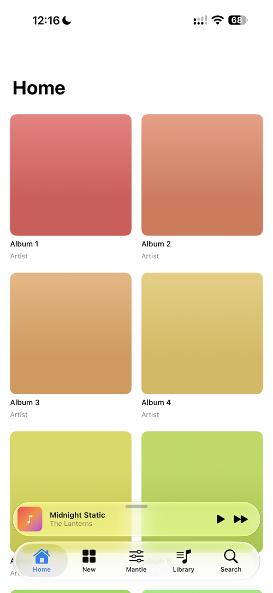
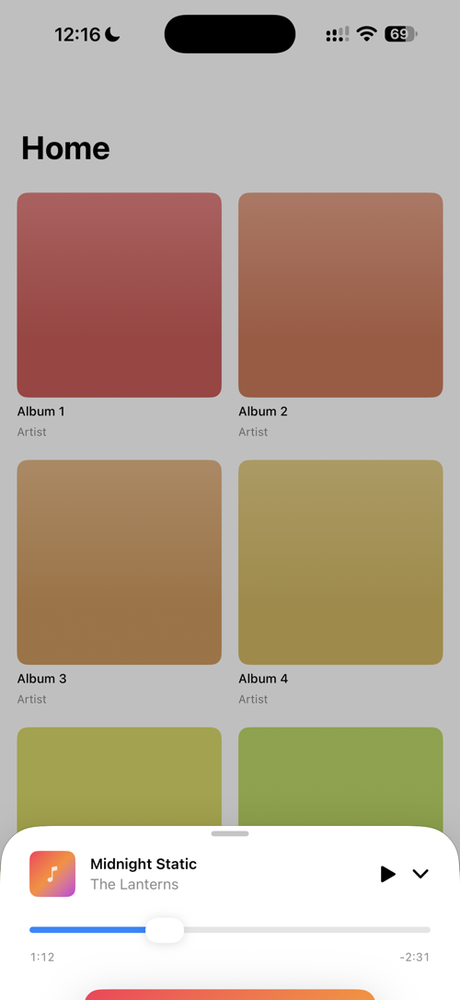
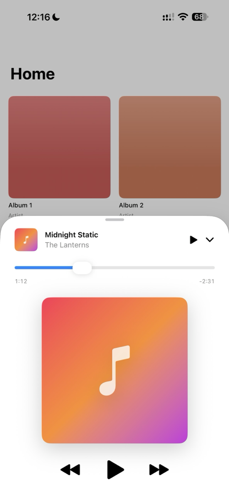
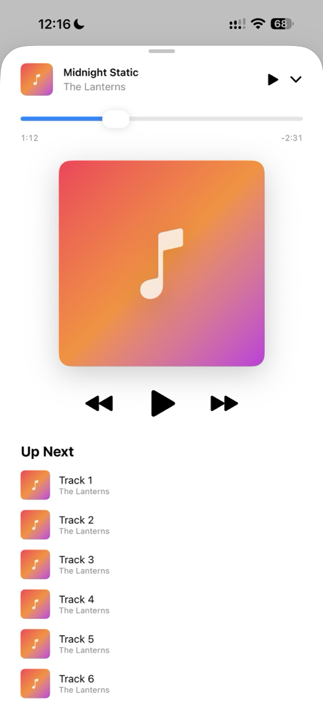

# Mantle

An Apple Music–style "now playing" surface for SwiftUI and UIKit: a bar that floats above the tab bar, and expands into a sheet you can drag between detents.

- **Collapsed**: a capsule that sits just above the tab bar. It measures the real tab bar, so it lines up on every device.
- **Expanded**: an edge-to-edge sheet that covers the tab bar. It snaps between detents: fixed sizes, fractions of the screen, or sizes measured from your content.
- **Backgrounds**: Liquid Glass, blur or opaque. The expanded sheet can use a different background, which fades in as it opens.
- **Two ways to interact**: draggable like a sheet (with a grabber), or a plain tap target that you open and close from code.
- **Content per detent**: different views pinned to each detent and cross-faded, or one expanded view that bigger detents reveal progressively.
- **Two engines, three ways to use it**: the SwiftUI `.mantle` API on a SwiftUI engine or a [UIKit engine](#engines) that runs at the display's full refresh rate, or [`MantleViewController`](#uikit-api) directly from UIKit.

<p align="center">
  
  
  
  
</p>
<p align="center"><sub>Collapsed, two content-measured snap points, and large. From the demo app, on the UIKit engine.</sub></p>

```swift
TabView { … }
    .mantle(selection: $detent) {
        Detent(.collapsed) { MiniPlayer() }
        ScrollView {
            Detent { Header() }       // first snap point: shows through Header
            Detent { Controls() }     // second snap point: shows through Controls
            Queue()                   // fully visible at .large, scrolls
        }
        .collapseTarget(.collapsed)   // dragging down from .large goes straight to the mini player
    }
    .mantleBackground(.glass, expanded: .opaque)
```

## Contents

- [Requirements](#requirements)
- [Installation](#installation)
- [Quick start](#quick-start)
- [Demo apps](#demo-apps)
- [Engines](#engines)
- [UIKit API](#uikit-api)
- [Detents](#detents)
- [Declaring content](#declaring-content)
  - [Pinned content](#pinned-content)
  - [Snap points](#snap-points)
  - [Expanded content](#expanded-content)
  - [Reveal markers](#reveal-markers)
  - [Two-state shorthand](#two-state-shorthand)
  - [How content is shown between detents](#how-content-is-shown-between-detents)
- [Collapse targets](#collapse-targets)
- [Controlling the mantle](#controlling-the-mantle) (including showing and hiding)
- [Interaction](#interaction)
- [Appearance](#appearance)
- [Tab bar integration and content insets](#tab-bar-integration-and-content-insets)
- [Accessibility](#accessibility)
- [Configuration reference](#configuration-reference)
- [Limitations](#limitations)
- [How it works](#how-it-works)

## Requirements

- iOS 26 or later (it uses Liquid Glass and `Group(subviews:)`)
- Swift tools 6.4
- For 120Hz on ProMotion iPhones, your app's `Info.plist` needs `CADisableMinimumFrameDurationOnPhone` set to `YES`. Without it, animations are capped at 60Hz.

## Installation

Add the package with Swift Package Manager. For a local checkout, in Xcode use **File → Add Package Dependencies… → Add Local…** and pick the `Mantle` folder. Then link the `Mantle` library to your app target.

```swift
import Mantle
```

## Quick start

Apply `.mantle` to the `TabView` itself, not to a tab's content. That way the expanded sheet covers the tab bar.

```swift
struct ContentView: View {
    @State private var detent: MantleDetent = .collapsed

    var body: some View {
        TabView {
            Tab("Home", systemImage: "house") { NavigationStack { Home() } }
            Tab("Library", systemImage: "music.note.list") { NavigationStack { Library() } }
        }
        .mantle(selection: $detent) {
            MiniPlayer()
        } expanded: {
            NowPlaying()
        }
    }
}
```

This gives you a mini player above the tab bar and a full-height player. Tap or drag the mini player up to open it, and drag the player down to close it.

## Demo apps

There are two, both mock music apps:

- **`Examples/MantleDemo`**: SwiftUI, using the `.mantle` API on either engine.
- **`Examples/MantleUIKitDemo`**: pure UIKit, with no SwiftUI and Auto Layout everywhere, built on `MantleViewController`. See [the UIKit demo](#the-uikit-demo).

### The SwiftUI demo

`Examples/MantleDemo` shows off most of the API. Open `Examples/MantleDemo/Mantle Demo.xcodeproj` and run the **Mantle Demo** scheme. It uses this package from the repo root (`../..`), so it always builds against the code next to it.

The **Mantle** tab has settings for:

- **Engine.** *UIKit* (the default in the demo), *SwiftUI*, or *UIKit API*, which swaps the app for a plain `UITabBarController` with a `MantleViewController`: a UIKit mini player and a hosted SwiftUI player.
- **Content mode.** *Reveal markers* is a scrolling player with named reveal snap points (`"header"`, `"artwork"`). *Fixed snap points* uses `.quarter`, `.half` and `.large`, revealing one player. *Per detent* has different content pinned to each detent.
- **Backgrounds** for the collapsed and expanded states.
- **Showing and hiding** the mantle (`isPresented`), the grabber, and dimming.
- **Dismissing.** Opts the middle snap point out of the inherited collapse target, with `.mantleCollapseMode(.nearest)`.
- **Move to.** Buttons that set the selection to each of the current mode's detents.

Launch arguments, handy for screenshots: `-engine uikit|swiftui|uikitapi` picks the engine, `-detent quarter|half|large|header|artwork` opens at a detent, and `-hideMantle YES` starts with the mantle hidden.

The demo's `Info.plist` sets `CADisableMinimumFrameDurationOnPhone`, so it runs at 120Hz on ProMotion iPhones.

### The UIKit demo

`Examples/MantleUIKitDemo` is a UIKit app: an app delegate and scene delegate, a `UITabBarController` with a compositional-layout album grid, and a `MantleViewController` installed above the tab bar. All mantle content is UIKit with Auto Layout. Open `Examples/MantleUIKitDemo/Mantle UIKit Demo.xcodeproj`.

The **Mantle** tab (a `UITableView`) switches between four demos and changes the mantle live:

| Demo | Shows |
| --- | --- |
| Reveal views | A scrolling player as `expandedContent`. Its header and artwork groups are `revealViews`, so the snap points come from Auto Layout. `expandedCollapseMode = .target(.collapsed)`. |
| Fixed snap points | A player as `expandedContent`, with `.quarter` and `.half` as `snapPoints` revealing its top. |
| Per detent | Different view controllers pinned to `.quarter`, `.half` and `.large` with `setContent(_:for:)`. |
| Tap target | `showsGrabber = false`: a tap-only bar with interactive glass, closed from code. |

It also has backgrounds, dimming, show/hide (`setPresented`), and *Move to* buttons for the current demo's detents. Launch arguments: `-demo revealViews|fixedSnapPoints|perDetent|tapTarget` and `-detent header|artwork|quarter|half|large`.

## Engines

The SwiftUI `.mantle` API runs on one of two engines. Pick with `.mantleEngine(_:)`:

```swift
TabView { … }
    .mantle(selection: $detent) { … }
    .mantleEngine(.uiKit)
```

| | `.swiftUI` (default) | `.uiKit` |
| --- | --- | --- |
| What moves the sheet | SwiftUI views and animations | A UIKit `MantleViewController`, installed directly in the `TabView`'s tab bar controller |
| Expand/collapse, measured on an iPhone 17 Pro Max | ~56fps, a few hitches | ~106fps, no hitches |
| App main-thread time per frame while moving (95th percentile) | ~7.5ms | ~1.7ms |
| Touch hit-testing | Through the SwiftUI view tree | Only the mantle's own views |
| Pull to dismiss from a scrolled list | No | Yes |
| Snaps to and from the bar | The morph happens between the bar and the first detent | Apple Music style: the morph spreads over the whole trip |

Measurements are from a scripted expand/collapse loop in the demo, recorded with Instruments' Animation Hitches template. Each build was installed explicitly, and the trace's symbols were checked to confirm which engine ran.

**How the UIKit engine works.**
- **Gestures:** a `UIPanGestureRecognizer` that cooperates with scroll views in the content.
- **Motion:** each snap springs only the sheet's top edge (a SwiftUI `Spring`, sampled by a 120Hz display link). The shape, cross-fades and background are derived from that position on every frame, so a bounce never squashes the sheet.
- **Cheap frames:** each frame is a handful of layer property sets. Content is laid out once, at fixed sizes, so moving the sheet never re-lays it out.

**Detent content on the UIKit engine** stays SwiftUI. Each detent's content is hosted in its own `UIHostingController`, which gets the surrounding environment (`\.self`) and the mantle proxy. Environment values set *above* the `.mantle` call reach your content. The hosting controllers ignore UIKit's safe area, so the mantle passes the home-indicator inset in as `.safeAreaPadding`.

**Springs.** The UIKit engine uses `.mantleSpring(_:collapse:)`:
- the main spring, default `Spring(duration: 0.5, bounce: 0.12)`, for moves between sheet detents;
- the `collapse` spring, default `Spring(duration: 0.3, bounce: 0.06)`, for moves to and from the collapsed bar.

The SwiftUI engine uses `.mantleAnimation(_:)`.

## UIKit API

`MantleViewController` is the UIKit engine itself, for UIKit apps:

```swift
let mantle = MantleViewController()
mantle.setContent(MiniPlayerViewController(), for: .collapsed)   // pinned content
mantle.expandedContent = UIHostingController(rootView: NowPlaying().environment(\.mantle, mantle.proxy))
mantle.snapPoints = [.half]                                      // content-less detents
mantle.expandedCollapseMode = .target(.collapsed)
mantle.background = .glass
mantle.expandedBackground = .opaque
mantle.onDetentChange = { detent in … }
mantle.install(in: tabBarController)                             // above the tab bar; insets every tab
```

| Member | |
| --- | --- |
| `setContent(_:for:)` | Pins a view controller to a detent. Pass `nil` to remove it. |
| `expandedContent` | Shown at the largest detent (an implicit `.large`), revealed progressively by smaller ones. |
| `snapPoints` | Detents without content of their own. |
| `revealViews` | Views in the expanded content whose bottom edges are snap points (`MantleRevealView(id:view:collapseMode:)`). See [Auto Layout and reveal views](#auto-layout-and-reveal-views). |
| `revealPoints` | Snap points at explicit offsets from the top of the expanded content (`MantleRevealPoint(id:offset:collapseMode:)`). Combined with `revealViews`. |
| `setCollapseMode(_:for:)`, `expandedCollapseMode` | See [collapse targets](#collapse-targets). |
| `detent`, `detents`, `onDetentChange` | The settled detent, all resting detents, and a callback when it settles somewhere new. |
| `move(to:animated:)`, `collapse()`, `expand()` | Move it. A reveal point that hasn't been measured yet is remembered until it has. |
| `setPresented(_:animated:)`, `isPresented` | Hide or show the whole mantle, collapsed bar included. |
| `proxy` | A `MantleProxy` for hosted SwiftUI content's `\.mantle` environment. Its actions always act on the mantle as it is now. |
| `background`, `expandedBackground`, `showsGrabber`, `dimsBackground`, `collapsedLayout`, `cornerRadius`, `tapDestination`, `spring`, `collapseSpring`, `contentInsetMode` | The same options as the SwiftUI modifiers. |
| `install(in:)`, `uninstall()` | `install(in: UITabBarController)` puts it above the tab bar and insets every tab. `install(in: UIViewController)` puts it over any view controller. |

For SwiftUI content in a `UIHostingController`, set `safeAreaRegions = []` and `sizingOptions = []`. Your content's layout then never changes as the sheet moves.

### Auto Layout and reveal views

**Content is laid out once, at its detent's size, and Auto Layout inside it works as usual.**
- **Pinned content:** each pinned view controller's view is sized to its detent.
- **Expanded content:** the expanded view controller's view is sized to the *largest* detent and pinned to the top of the sheet.
- **Moving the sheet never resizes either,** so your constraints aren't re-solved during drags or snaps. They're re-solved only on real size changes, like rotation.

**Smaller snap points clip the expanded content.** They show the top of the same, fully rendered view. To reveal a stack group by group, list the groups as `revealViews`:

```swift
let player = PlayerViewController()             // a top-aligned stack: header, controls, lyrics, queue
mantle.expandedContent = player                 // rendered whole, at the largest size
player.loadViewIfNeeded()
mantle.revealViews = [                          // a snap point at the bottom of each group
    MantleRevealView(id: "header", view: player.header),
    MantleRevealView(id: "controls", view: player.controls),
    MantleRevealView(id: "lyrics", view: player.lyrics),
]                                               // the queue is revealed at .large
```

- **Measured after layout.** After each layout pass, the mantle measures each view's bottom edge in the expanded content's coordinates. It shows the content down to that edge, plus the home-indicator area.
- **Scroll-independent.** Inside a scroll view, views are measured in the scroll **content's** coordinates, as if it were scrolled to the top, so scrolling never moves a snap point.
- **Live.** Frame changes (Auto Layout updates, Dynamic Type, content changes) re-measure through KVO, so snap points follow your layout.
- **Named or numbered.** Address them as `.revealed("id")`, or `.revealed(0)`, `.revealed(1)`, … from the top if unnamed. Each can have its own `collapseMode`.
- **Top-align the content.** The sheet reveals it from the top down.
- **Spacing below a group** sits under its snap point, so a stop doesn't show part of the next group.

Content that should *change* per size, rather than just be revealed, belongs in `setContent(_:for:)`. You can mix both.

## Detents

A `MantleDetent` is a position the mantle can rest at.

| Detent | Position |
| --- | --- |
| `.collapsed` | The floating bar above the tab bar. |
| `.fraction(f)` | A sheet covering `f` of the screen height (0…1). |
| `.quarter` | `.fraction(0.25)` |
| `.half` | `.fraction(0.5)` |
| `.height(h)` | A sheet whose visible height above the bottom safe area is `h` points. |
| `.large` | A full-height sheet whose top edge sits just below the top safe area, like a SwiftUI `.large` sheet. |
| `.fullScreen` | Covers the whole screen edge to edge, including the status bar area. Content is still kept out of the status bar and Dynamic Island. |
| `.revealed(i)` | The snap point defined by the `i`th unnamed [reveal marker](#reveal-markers), counting from the top (0 = first). |
| `.revealed("name")` | The snap point defined by `Detent(id: "name") { … }`. |

- `.fraction` and `.height` never go taller than `.large`.
- The smallest declared detent is the **resting state**. If it's `.collapsed`, the mantle rests as the floating bar. Without a `.collapsed` detent, it rests as a sheet at its smallest detent.
- If you set the selection to a detent that hasn't been declared (or hasn't been measured yet), the mantle goes to the resting state.

## Declaring content

The `.mantle(selection:detents:)` builder takes `Detent` views and plain views. There are four building blocks, and you can mix them.

### Pinned content

`Detent(.half) { … }` shows its own views at that detent. The views are laid out at the size the sheet has *at that detent* (anchored to the top), and they cross-fade with their neighbours as the sheet moves.

```swift
.mantle(selection: $detent) {
    Detent(.collapsed) { MiniPlayer() }
    Detent(.quarter)   { CompactControls() }
    Detent(.half)      { Queue() }
    Detent(.large)     { NowPlaying() }
}
```

### Snap points

`Detent(.half)` with no content is a snap point only. At that detent it shows the **next larger detent's** content, laid out at the larger size and top-aligned, so the sheet reveals more of it as it grows.

```swift
Detent(.collapsed) { MiniPlayer() }
Detent(.quarter)                  // shows the top of NowPlaying
Detent(.half)                     // shows more of it
Detent(.large) { NowPlaying() }
```

### Expanded content

Views in the builder that aren't wrapped in a `Detent` become the **expanded content**:

- It lives at `.large`. If no `.large` is declared, an implicit `.large` detent is added for it.
- If you declare a content-less detent that's at least as tall as `.large` (e.g. `Detent(.fullScreen)`), the expanded content lives there instead.
- Smaller declared detents become snap points that reveal it.

```swift
.mantle(selection: $detent) {
    Detent(.collapsed) { MiniPlayer() }
    Detent(.quarter)
    Detent(.half)
    NowPlaying()                      // at the implicit .large
}
```

### Reveal markers

`Detent { … }` with **no detent argument** is a reveal marker. Put it anywhere *inside* the expanded content, including inside a `ScrollView`. The mantle measures each marker and adds a snap point sized to show the expanded content down to the bottom of that group (plus the home-indicator area).

```swift
.mantle(selection: $detent) {
    Detent(.collapsed) { MiniPlayer() }
    ScrollView {
        VStack(spacing: 24) {
            Detent { Header() }                       // .revealed(0)
            Detent(id: "controls") { Controls() }     // .revealed("controls")
            Queue()                                   // only fully visible at .large
        }
    }
}
```

- Unnamed markers are numbered from the top in document order: `.revealed(0)`, `.revealed(1)`, …
- A marker's content is stacked vertically (`VStack(spacing: 0)`).
- Markers that would be taller than the expanded content's detent, or shorter than the resting state, are ignored.
- Snap points are measured whenever the layout changes, except while the sheet is at its largest detent. There the content may be scrolled, which would move the markers, so the last measurement is kept.

### Two-state shorthand

For the common "mini player + full player" case:

```swift
.mantle(selection: $detent, detents: [.quarter, .half]) {
    MiniPlayer()
} expanded: {
    NowPlaying()
}
```

This is the same as `Detent(.collapsed) { MiniPlayer() }`, a content-less `Detent` for each of `detents`, and `NowPlaying()` as the expanded content. `detents` defaults to `[]`, which leaves just collapsed and `.large`. Reveal markers inside `expanded` work as usual.

There's also a version that manages its own state:

```swift
.mantle {
    Detent(.collapsed) { MiniPlayer() }
    NowPlaying()
}
```

Inside it, use the [environment proxy](#controlling-the-mantle) to move it.

### How content is shown between detents

- **Cross-fading.** Each piece of content fades out over the trip from its detent to the next detent up, with or without content. The next content fades in over the same stretch. After that, it stays fully visible across any snap points in between, which reveal it progressively.
- **Programmatic jumps.** These include taps, selection changes and collapse targets. Only the start and end content cross-fade, so jumping from collapsed to `.large` doesn't flash the `.half` content on the way.
- **Safe area.** Content in expanded detents is padded to stay clear of the home indicator. On `.fullScreen`, it's also pushed below the status bar as the sheet reaches it. The collapsed content gets no padding.
- **Hit testing and accessibility.** Content is hit-testable and visible to accessibility only while it's more than half faded in.

## Collapse targets

By default, a drag down settles on the nearest smaller detent. A detent's **collapse mode** changes that.

| `MantleCollapseMode` | A drag down from this detent… |
| --- | --- |
| `.automatic` (default) | On a snap point without content of its own: does whatever the content it shows does (see below). Elsewhere: the same as `.nearest`. |
| `.nearest` | Settles on the nearest smaller detent. Use it to opt a snap point out of an inherited target. |
| `.target(d)` | Goes straight to `d` if the release would land on any smaller detent. |

Set it with `.mantleCollapseMode(_:)`. `.collapseTarget(d)` is shorthand for `.mantleCollapseMode(.target(d))`.

```swift
// On a pinned detent
Detent(.large) { NowPlaying() }
    .collapseTarget(.collapsed)

// On the expanded content: applies to the detent it lives at (usually .large)
// and, through inheritance, to every snap point that reveals it
ScrollView {
    Detent { Header() }                    // inherits: collapses
    Detent { Controls() }
        .mantleCollapseMode(.nearest)      // opts out: steps down to Header
    Queue()
}
.collapseTarget(.collapsed)                // .large collapses
```

- **Snap points inherit.** A snap point without content of its own (a content-less `Detent(.half)` or a reveal marker) shows another detent's content. In `.automatic` mode it takes that content's collapse mode, so dismissing the content behaves the same from any of its snap points. Give the snap point its own mode to override this, e.g. `.nearest` to step down instead.
- **Only downward.** A target is only used when it's smaller than the detent the drag started at, so a downward drag never sends the sheet up. Upward drags are unaffected.
- **Cross-fading.** When a target skips detents, only the start and end content cross-fade.
- **Where it works.** The modifiers work on views at the top level of the builder, and on `Detent`s anywhere (including reveal markers). Elsewhere they have no effect.

## Controlling the mantle

**Selection binding.** The mantle animates whenever the binding changes. When the user drags, taps, or you move it through the proxy, it writes back once the sheet has **settled** at its new detent, not when the gesture ends. Doing it then keeps the re-render it causes away from frames that are still moving. That includes reveal snap points, by index or by name:

```swift
@State private var detent: MantleDetent = .collapsed
…
Button("Show queue") { detent = .half }
Button("Show artwork") { detent = .revealed("artwork") }   // Detent(id: "artwork") { … }
```

Name the reveal markers you present from code (`Detent(id:)`). Unlike indices, names don't shift when markers are added or reordered. Named markers aren't counted in `.revealed(i)` indices.

**Showing and hiding.** Pass `isPresented` to hide the mantle entirely, collapsed bar included:

```swift
@State private var showsPlayer = false
…
TabView { … }
    .mantle(isPresented: $showsPlayer, selection: $detent) { … }
```

- When it becomes `false`, the mantle slides down and fades out (using `.mantleAnimation`), and its content inset is removed, so the content beneath gets its full height back. When it becomes `true`, it slides back in at the current selection.
- Every `.mantle` variant takes it, and it defaults to always shown. The mantle never changes it itself.
- While hidden, the mantle's internal state (and, for the self-managed `.mantle { … }`, its selection) is reset.

**Environment proxy.** Views inside the mantle can read `@Environment(\.mantle)`:

```swift
struct NowPlaying: View {
    @Environment(\.mantle) private var mantle

    var body: some View {
        Button("Close", systemImage: "chevron.down") { mantle.collapse() }
    }
}
```

| Member | |
| --- | --- |
| `detent` | The detent the mantle is resting at, or animating to. |
| `detents` | All resting detents, smallest first, including measured reveal snap points. |
| `isExpanded` | `true` anywhere other than `.collapsed`. |
| `move(to:)` | Animates to a detent. If it doesn't exist, goes to the resting state. |
| `collapse()` | Animates to the resting (smallest) detent. |
| `expand()` | Animates to the largest detent. |

Outside a mantle the proxy is inert, and its actions do nothing.

## Interaction

### With a grabber (default)

`.mantleGrabber(.visible)` or `.automatic` makes the mantle behave like a sheet. A grabber only appears when there's more than one detent.

- **Grabber.** Visible in every state, including on the collapsed bar.
- **Dragging.** Drag anywhere on the surface to move it. The top edge follows your finger, and dragging past the smallest or largest detent rubber-bands.
- **Snapping.** On release, the mantle projects where a flick would carry it and snaps to the closest detent, or to its [collapse target](#collapse-targets). The snap spring starts at your release velocity.
- **Tapping the collapsed bar.** Opens it to the tap destination. That defaults to the largest detent; change it with `.mantleTapDestination(_:)`.
- **Scroll views in the content.** These only scroll at the **largest** detent. Below it, drags move the sheet and the content stays where it was.
  - **SwiftUI engine:** at the largest detent, the strip around the grabber still drags the sheet down, even over a scroll view.
  - **UIKit engine:** like a UIKit sheet. At the largest detent, a scrolled list scrolls. A list at its top scrolls when you push up and moves the sheet when you pull down. If you scroll back up to the top and keep pulling, the sheet takes over mid-gesture (pull to dismiss). Leaving the largest detent for a smaller one scrolls the list back to its top, since snap points are measured from the top of the content.

### Without a grabber

`.mantleGrabber(.hidden)` turns the mantle into a tap target. It can't be dragged. Tapping the collapsed bar opens it to the tap destination, and you close or move it from code, using the [selection binding or the proxy](#controlling-the-mantle).

### Dimming

`.mantleDimming(true)`, the default, dims the content behind the mantle in proportion to how far it has opened, up to 25% black. Tapping the dimmed area collapses the mantle. `.mantleDimming(false)` turns this off, and the content behind stays interactive.

## Appearance

### Backgrounds

```swift
.mantleBackground(.glass)                                     // Liquid Glass (default)
.mantleBackground(.glass(.regular.tint(.pink)))               // any Glass variant
.mantleBackground(.blur)                                      // regular material
.mantleBackground(.blur(.ultraThin))                          // any Material
.mantleBackground(.opaque)                                    // system background colour
.mantleBackground(.opaque(.indigo.gradient))                  // any ShapeStyle

// A different background when expanded, faded in as it opens (Apple Music style):
.mantleBackground(.glass, expanded: .opaque)
```

- Each background has a UIKit form for the UIKit engine and `MantleViewController`:
  - **Glass:** SwiftUI `Glass` maps by equality (`.regular`, `.clear`). A tint can't be read back out of a `Glass`, so tinted glass becomes plain regular glass in UIKit.
  - **Materials:** map to the matching `UIBlurEffect` style.
  - **Colours:** convert directly. Other shape styles use the system background colour.
  - **Exact UIKit backgrounds:** use `.glass(uiKit:tint:)`, `.blur(uiKit:)` or `.opaque(uiKit:)`. These also map back to SwiftUI.
- Glass can't be faded with opacity. If either end is glass, the glass is the base layer and the other background fades in or out on top of it.
- In tap-target mode (`.mantleGrabber(.hidden)`), the collapsed glass is interactive (the system's press response). In sheet mode it isn't: that recogniser would compete with the drag, and toggling it rebuilds the glass.
- Non-glass collapsed backgrounds get a soft shadow, which fades as the mantle opens.

### Shape and size

```swift
.mantleCollapsedLayout(height: 56, horizontalInset: 20, bottomInset: 8)
.mantleCornerRadius(38)          // expanded sheet; the collapsed bar is always a capsule
.mantleAnimation(.spring(duration: 0.5, bounce: 0.12))   // programmatic and tap moves
```

- `height`: height of the collapsed bar.
- `horizontalInset`: gap between the bar and the leading and trailing screen edges.
- `bottomInset`: gap between the bar and the top of the tab bar. With no visible tab bar, it's the gap above the bottom safe area.

The surface's corner radius, side insets and bottom gap morph from the capsule into the sheet as it moves.
- **Dragging, on both engines:** the morph happens over the trip from the collapsed bar to the first detent above it.
- **UIKit engine snaps to or from the bar:** these follow Apple Music.
  - The morph spreads over the whole trip. The sides draw in evenly, and the bottom stays on the screen's edge, over the tab bar, until the very end.
  - The bar's content shows at the top of the card for the first 30% of the trip back to it, while the other content fades over the middle.
  - The quick `collapse` spring overshoots only along the direction of travel: a dismiss dips just below the bar and settles.

## Tab bar integration and content insets

The mantle does two things with the tab bar:

- **Positioning.** The mantle measures the tab bar's frame and places the collapsed bar to suit it. That holds across devices, rotation, folding and tab bar changes:
  - **A tab bar along the bottom (iPhone):** the bar sits `bottomInset` above it, across the screen width.
  - **A vertical tab bar at the side (iPhone Duo, folded and unfolded):** the bar sits `bottomInset` above the bottom safe area, across the content area beside the tab bar, and not attached to it. Expanded, the sheet is full width and covers the tab bar.
  - **No tab bar:** the bar sits above the bottom safe area, across the screen width.
- **Content insets.** Like a tab view bottom accessory, the collapsed bar is added to the bottom safe area of the content underneath. That lets scroll views scroll their last rows clear of it. The inset is the bar's `height + bottomInset`.

SwiftUI safe-area changes made outside a `TabView` don't reach inside its tabs, or inside a `NavigationStack`. So each of these works through a fallback chain:

1. **UIKit (`.automatic` mode).** The mantle finds the `UITabBar` and its `UITabBarController`.
   - It watches the tab bar's frame for positioning.
   - It adds the inset to every tab's `additionalSafeAreaInsets.bottom`. Each tab's own inset is kept, added to, and restored exactly when the mantle goes away.
   - The inset stays while a pushed screen hides the tab bar.
2. **SwiftUI (`.mantleSafeAreaInset()` on each screen).** Each screen that applies it:
   - adds the inset to its own bottom safe area;
   - measures its bottom safe-area edge, which inside a tab is the top of the tab bar, and reports it to the mantle for positioning.

   This is plain SwiftUI. It's the only mechanism in `.manual` mode, and the fallback in `.automatic` mode whenever the UIKit tab bar can't be found.
3. **Neither.** The collapsed bar sits above the bottom safe area, and a SwiftUI `safeAreaInset` is applied to the view the mantle is attached to. That works for hosts that aren't a `TabView`.

`.mantleContentInsetMode(_:)` picks the mode:

- **`.automatic` (default).** UIKit first, then any screens using `.mantleSafeAreaInset()`, then the plain fallback. While the UIKit path is working, `.mantleSafeAreaInset()` adds nothing, so it never doubles up the inset. **Adding `.mantleSafeAreaInset()` to every screen makes an app independent of how `TabView` is built:** if a future SwiftUI no longer uses `UITabBar`, the SwiftUI path takes over automatically.
- **`.manual`.** The mantle doesn't inset anything through UIKit, and positions the bar from what the screens report. (It only reads the UIKit tab bar if no screen reports in.) Apply `.mantleSafeAreaInset()` yourself, **inside** the navigation stack, on every screen:

  ```swift
  TabView {
      Tab("Home", systemImage: "house") {
          NavigationStack {
              Home()
                  .mantleSafeAreaInset()
                  .navigationDestination(for: Album.self) { album in
                      AlbumView(album).mantleSafeAreaInset()
                  }
          }
      }
  }
  .mantle(selection: $detent) { … }
  .mantleContentInsetMode(.manual)
  ```

Apply `.mantleSafeAreaInset()` to a screen's root view, one that fills the screen (a `ScrollView`, `List` or `Form`). Its bottom edge is what gets measured. When several screens apply it, the most recently shown one counts.

All three paths were measured on iOS 27.2 to give the same scroll inset and the same bar position, including a build with UIKit tab bar detection disabled.

## Accessibility

- **Collapsed.** The bar is a single button element combining its content. Activating it opens the mantle.
- **Expanded.** The content's own elements are exposed.
- **Actions.** In every state there's an **Expand** custom action, and the escape gesture (two-finger Z) collapses.
- **Decoration.** The grabber and dimming are hidden from accessibility.
- **Faded content.** Content that's faded out is hidden from accessibility.

## Configuration reference

Configuration modifiers set environment values, so apply them anywhere above the mantle, usually right after `.mantle(...)`. Visibility is the `isPresented` parameter of `.mantle(...)` itself.

| Modifier | Default | |
| --- | --- | --- |
| `.mantleBackground(_:expanded:)` | `.glass`, no expanded override | Surface background(s). |
| `.mantleGrabber(_:)` | `.automatic` (visible) | `.hidden` turns off dragging. |
| `.mantleCollapsedLayout(height:horizontalInset:bottomInset:)` | 56, 20, 8 | Collapsed bar geometry. Also takes a `MantleCollapsedLayout`. |
| `.mantleCornerRadius(_:)` | 38 | Expanded sheet corner radius. |
| `.mantleDimming(_:)` | `true` | Dim (and tap-to-collapse) behind the mantle. |
| `.mantleTapDestination(_:)` | largest detent | Where tapping the collapsed bar goes. |
| `.mantleEngine(_:)` | `.swiftUI` | See [engines](#engines). |
| `.mantleAnimation(_:)` | `.spring(duration: 0.5, bounce: 0.12)` | SwiftUI engine: programmatic and tap-driven moves. Drags use a velocity-matched spring. |
| `.mantleSpring(_:collapse:)` | `Spring(duration: 0.5, bounce: 0.12)`, `Spring(duration: 0.3, bounce: 0.06)` | UIKit engine: moves between sheet detents, and moves to and from the collapsed bar. |
| `.mantleContentInsetMode(_:)` | `.automatic` | See [content insets](#tab-bar-integration-and-content-insets). |
| `.mantleSafeAreaInset()` | | Per-screen inset and tab bar position, in plain SwiftUI. See [content insets](#tab-bar-integration-and-content-insets). |
| `.mantleCollapseMode(_:)` | `.automatic` | On a `Detent` or the expanded content. See [collapse targets](#collapse-targets). |
| `.collapseTarget(_:)` | | Shorthand for `.mantleCollapseMode(.target(_:))`. |

## Limitations

- **The SwiftUI engine renders at about 60fps** on a 120Hz screen, and has no pull to dismiss from scrolled content. Use the UIKit engine for both.
- **UIKit engine: the content isn't one SwiftUI tree.** Each detent's content is in its own hosting controller. It receives the surrounding environment, but preferences don't flow back out of it, and some environment values may not carry over through `\.self`. The collapsed and expanded content are separate views, so matching elements (the mini player's title and the full player's header) briefly overlap during a morph instead of moving into each other.
- **Measured snap points can go stale.** If the expanded content changes size while the sheet is at its largest detent, reveal snap points update when it next leaves that detent.
- **No presenting-view scale effect.** Unlike system sheets, the content behind isn't scaled back while the sheet is open.
- **Automatic mode leans on UIKit internals.** Its zero-setup path depends on SwiftUI's `TabView` being backed by a `UITabBarController`. Screens that apply `.mantleSafeAreaInset()` keep working without it. Screens that don't would lose their inset, and without any reporting screen the bar would overlap the tab bar.
- **One mantle per hierarchy.** Nested or multiple mantles aren't supported.

## How it works

| File | |
| --- | --- |
| `Mantle.swift` | The `.mantle` modifiers; `MantleRoot` (visibility, content inset and tab bar position fallback chain); `MantleHost` (state, dragging, snapping, splitting the builder into detents and expanded content via `Group(subviews:)`). |
| `MantleDetent.swift` | `MantleDetent`, the `Detent` view (pinned, snap point, reveal marker), `MantleCollapseMode` and its modifiers. Reveal markers report their frames through a preference key. |
| `MantleLayout.swift` | Pure geometry: where each detent rests, the surface frame, corner radius, content insets and cross-fade weights at any top-edge position. |
| `MantleSurface.swift` | Draws the surface. It's `Animatable` on its top edge, so every derived property follows the same path whether it's dragged, flicked or animated. Also the background blending. |
| `MantleConfiguration.swift` | Backgrounds, collapsed layout, content inset modes, configuration modifiers, and the `MantleProxy` environment value. |
| `Examples/MantleDemo`, `Examples/MantleUIKitDemo` | The [demo apps](#demo-apps). Not part of the package, so they aren't built for apps that depend on Mantle. |
| `UIKit/MantleViewController.swift` | The UIKit engine and API: layout, pan and scroll-view cooperation, spring snaps, tab bar installation. |
| `UIKit/MantleSurfaceView.swift` | The UIKit surface: glass, blur or colour background with cross-fade, continuous-corner clipping, grabber. |
| `UIKit/MantleFrameDriver.swift` | The 120Hz display link that samples snap springs. |
| `UIKit/MantleUIKitHost.swift` | The SwiftUI `.mantle` API on the UIKit engine: resolves the builder, hosts each detent's content, installs the controller in the tab bar controller. |
| `TabBarReader.swift` | A UIKit probe that measures the tab bar and applies the automatic tab insets. |
| `MantleScreenInset.swift` | `.mantleSafeAreaInset()` and the reporter that carries screens' safe-area edges to the mantle through the environment. |

On both engines, the whole surface is driven by one number: the sheet's top edge. Dragging sets it directly. Snapping and programmatic moves spring it, and everything else (frame, shape, fades, backgrounds) is derived from it on every frame, using the same `MantleLayout` geometry.
